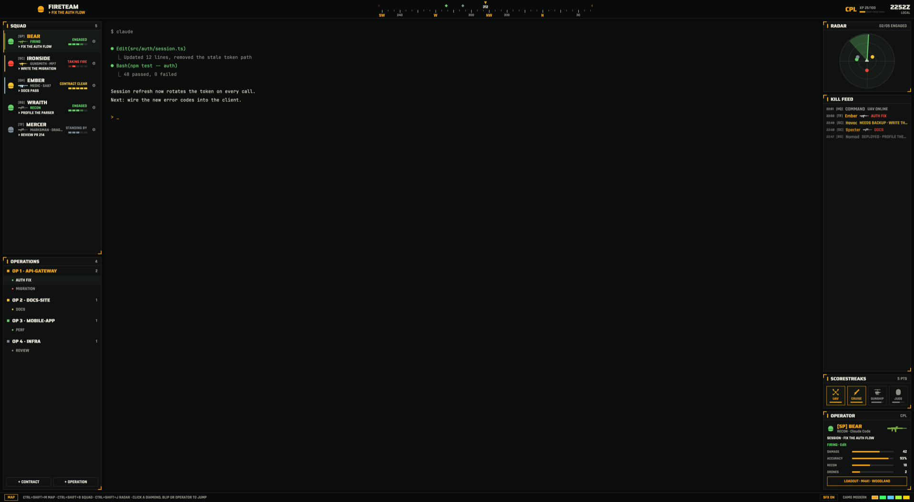

# Fireteam

A military-shooter HUD for [Herdr](https://herdr.dev) (the **herdr-app** GUI build). Your coding agents become
a fireteam of operators, and the window becomes the game HUD around one big terminal: a compass with objective
markers, a squad widget, a radar, a kill feed, scorestreaks, XP popups with sound, and a loadout screen with
weapons, camo and perks that really change the HUD.



This is an unofficial community layout, inspired by the look of modern military shooters. It is not affiliated
with or endorsed by Herdr or by any game publisher, and it uses no official art, logos, fonts or characters.
Everything is drawn natively from live Herdr data; the screenshot above uses invented demo data.

## What you get

| HUD piece | What it is |
|---|---|
| **Compass** (top) | A heading scale with a diamond per operator at its own bearing, red and flashing when it is under fire. Click one to jump to it. The heading is the focused operator's. |
| **Squad** (left) | Every agent as an operator: `[unit] callsign`, role, weapon silhouette, live action, state word, five armour plates, and its **session name**. The gear opens its loadout. |
| **Operations** (left) | Spaces as operations, tabs as contracts. |
| **Radar** (right) | A blip per operator and a sweep. Click a blip to jump. |
| **Kill feed** | A finished contract is a kill: `[unit] callsign <weapon> CONTRACT`. Also under fire, engaged, deployed, extracted, commits and pushes. |
| **Scorestreaks** | Charged by finished contracts: UAV 3 (jump to the operator under fire), Cruise 5 (jump to a finished one), Gunship 7 (zoom the terminal), Juggernaut 9 (new terminal). |
| **Operator card** | The focused operator: weapon, live action and stats from real tool calls (DAMAGE edits and commands, ACCURACY successes vs failures, RECON reads, DRONES subagents). |
| **XP popup + sound** | A banner over the terminal for DIRECT HIT, DAMAGE TAKEN, CONTRACT ACCEPTED/CLEAR, RANGE CLEAR (tests), INTEL SECURED (commit), EXFIL CONFIRMED (push), DRONE DEPLOYED (subagent). Five synthesised sounds; `SFX ON/OFF` in the bottom bar. |
| **Loadout** | The gear on a row, LOADOUT on the card, or `ctrl-shift-o`: 9 weapons, 8 camos, 3 perk slots. Saved per terminal. |
| **Operations map** | `ctrl-shift-m` or the MAP button: operations as grid zones, contracts as pins, operators standing on them. Click to jump. |
| **Rank** | PVT to GEN, one rank per 4 finished contracts. |
| **Camo packs** | Click a swatch in the bottom bar: MODERN, NVG, ARCTIC, ZOMBIES, HAZARD. Matching terminal themes (`Fireteam`, `Fireteam-NVG`, …) are in the settings theme picker. |

**Perks** (each acts on the HUD): Ghost hides the operator from radar and compass; Cold-Blooded makes failed tools
do no damage (no popup, sound or accuracy hit); Quick Fix adds an armour plate; Scavenger adds a streak charge per
finished contract; Overkill doubles popup XP; Fast Hands pops RELOADED (+25 XP) when a context compaction ends;
Tracker (while that operator is focused) reveals Ghosts; Dead Silence mutes that operator's popups and sounds;
Hardline (while that operator is focused) makes streaks cost one contract less.

Roles come from the program: Claude Code is Recon, Codex Gunsmith, Gemini Medic, OpenCode/pi/amp/cursor
Marksman, shells Sentry, anything else Operator. Callsign and unit tag come from a hash of the terminal address.

## Install

Ask your agent to add `herdr.dev/layouts/pradyb/herdr-fireteam`, or:

```sh
git clone https://github.com/pradyb/herdr-fireteam
cd herdr-fireteam
tools/install.sh                                  # layout, themes, mod into ~/.config/herdr-app; links the hook
herdr-app do layout.switch '{"name":"Fireteam"}'
```

Then merge `mods/fireteam/KEYS.json` into your `keys.json`: `ctrl-shift-m` map, `ctrl-shift-o` loadout,
`ctrl-shift-b` squad column, `ctrl-shift-j` radar column. Run `tools/install.sh` again after a `git pull`.
It installs real files, not symlinks: Herdr hot-reloads mods and loads images only from real files in its home.
Back to your own layout any time with `ctrl-shift-l`; `ctrl-alt-shift-escape` resets to the default layout.

### Live events (optional, Claude Code)

Herdr itself reports four states (working, blocked, done, idle). The hook adds a live action per agent, hit and
damage events, and the stats. `tools/install.sh` links `hooks/fireteam-activity.py` to `~/.claude/hooks/`; register
it in `~/.claude/settings.json` for `UserPromptSubmit`, `PreToolUse`, `PostToolUse`, `PostToolUseFailure`,
`PreCompact`, `SubagentStart`, `SubagentStop`, `Stop`, `SessionStart`, `SessionEnd`. Each entry looks like this:

```json
{ "hooks": [{ "type": "command", "command": "python3 \"$HOME/.claude/hooks/fireteam-activity.py\" 2>/dev/null || true", "timeout": 5 }] }
```

It answers at once (async), does nothing outside Herdr, and writes `~/.local/state/fireteam/<terminal>.json`.
Without it the HUD still works from Herdr's four states. Other agents would need their own hook writing the same file
(fields are documented at the top of the script).

## What it reads and runs

- `~/.local/state/fireteam/<terminal>.json`, if the hook is installed.
- Its own folder (art, sounds, fonts).
- Nothing else: no network calls, no programs run, no files written outside Herdr's shared state.

## Customise

Everything visual is in `mods/fireteam/kit.js`: the `PACKS` palettes, `CALLSIGNS`, `UNITS`, `ROLES` (weapon per
role), `WEAPONS`, `CAMOS`, `PERKS`, `STREAKS` and `RANKS`. Sizes are in `layouts/Fireteam.json`. See
[CONTRIBUTING.md](CONTRIBUTING.md) and [RECIPE.md](RECIPE.md).

## Credits

By pradyb, MIT licensed. The Claude Code hook is derived from
[World of Codecraft](https://github.com/kevinpardo/world-of-codecraft) by Kevin Pardo (MIT). The sounds are
synthesised by `tools/make_sounds.py`. Fonts: Saira Stencil One and Rajdhani, SIL Open Font License.
