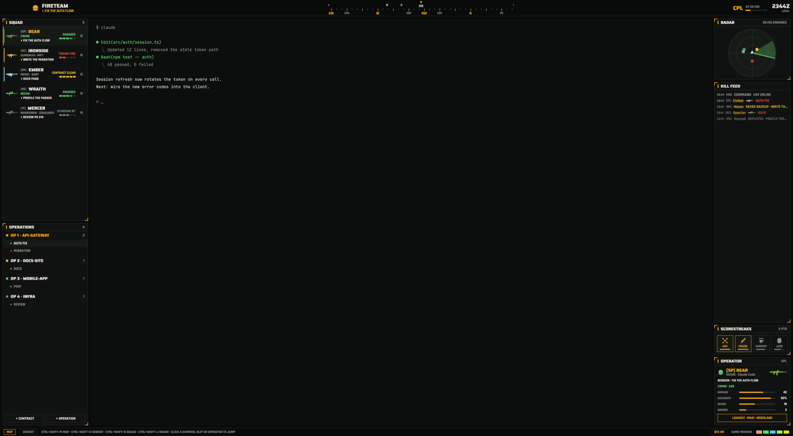

# Fireteam

A military-shooter HUD for Herdr. A thin top bar holds the logo, a compass with a diamond per agent, the rank and
the clock. A squad and operations column sits on the left, one big terminal in the middle, and a radar, kill feed,
scorestreaks and operator card on the right, with a slim key-hint bar at the bottom. Every agent is an operator with
a callsign, a weapon and a live action. Flat dark panels, 1px hairlines, one amber accent, stencil caps. Drawn natively,
no images except small SVG icons.

## What you see

Window background `#090b0a`, `titlebar: none` (macOS traffic lights at 16,18), terminal font JetBrains Mono, UI font
Rajdhani (body) and Saira Stencil One (headings, uppercase), both bundled in `mods/fireteam/fonts/`.

- **Top bar** (52px, window drag): at x=76 a helmet icon and "FIRETEAM" (stencil 17px) with the focused operator's
  session name under it in amber (`▸ SESSION NAME`), or `OP n · space` when none. In the middle a 600px compass: a
  tick every 5° (major every 15°), cardinals N/NE/E… in amber, numbers every 30°, ±90° visible at 3.33px/degree, a
  `▼` caret and the heading number at the centre; a `◆` per agent at its bearing (`hash(address) % 360`), coloured by
  status, 12% opaque for a Ghost, flashing when blocked, clicking runs `agent.focus`. Right: rank (PVT…GEN) with a
  4-segment XP bar, and the clock as `HHMMZ`.
- **Left column** (292px, min 220, max 440): two panels with 1px borders `#ffffff1c`, background `#101311`, and amber
  2px corner ticks at top-left and bottom-right. **SQUAD**: one 62px row per agent: helmet icon in the status colour,
  `[UNIT] CALLSIGN`, weapon silhouette (tinted by camo) and live action or `ROLE · WEAPON`, the session name
  (`▸ NAME`), state word, five armour plates, and a ⚙ opening the loadout. The focused row has a 2px amber bar. **OPERATIONS**:
  `OP n · space` headers with their tabs as `CONTRACT n` rows, plus `+ CONTRACT` / `+ OPERATION` buttons.
- **Terminal** (middle): the active tab with a 26px pane header on top: helmet, callsign, weapon, role, live action,
  title and folder, then split/zoom/close buttons. Panes have a 1px `#ffffff1c` border, 1px amber when focused, gap 8.
- **Right column** (262px, min 220, max 400): **RADAR** (156px circle, three rings, a crosshair, a sweep line turning
  every 4.2s, a 10px blip per operator at `hash`-derived angle and radius, green/red/amber/grey by status),
  **KILL FEED** (8 rows, time, `[UNIT]`, callsign, weapon icon on kills, target), **SCORESTREAKS** (four tiles UAV 3,
  CRUISE 5, GUNSHIP 7, JUGG 9 with a charge bar, pulsing amber when ready), **OPERATOR** (callsign, weapon, session, live
  action, DAMAGE/ACCURACY/RECON/DRONES bars, a LOADOUT button).
- **Bottom bar** (26px): a MAP button, key hints, `SFX ON/OFF`, the camo name and five camo swatches.
- **XP popup**: a floating banner at the top centre of the terminal block for 2.6s: a pulsing `✕` (or `✚` for damage),
  the event in stencil, the operator and session and `+N XP`.

Camo packs (accent colours): MODERN `#f2a516`, NVG `#39ff6a`, ARCTIC `#5cc8ff`, ZOMBIES `#a8ff3c`, HAZARD `#ffd400`.
Status colours in MODERN: working `#63d06a`, blocked `#ff4a3d`, done `#f2c230`, idle `#7d8a91`.

## How it behaves

- **Statuses**: working = ENGAGED (4 plates, last pulsing), blocked = TAKING FIRE (1 flashing plate, red blip and
  diamond flashing), done = CONTRACT CLEAR (5 amber plates), idle = STANDING BY (3 grey plates).
- **Roles** from the program: claude Recon (M4A1), codex Gunsmith (MP7), gemini Medic (SA87), opencode/pi/amp/cursor
  Marksman (Dragunov), shells Sentry (Model 680), others Operator (1911).
- **Events**: a poll every 1.2s diffs Herdr's statuses (working→done/idle is a kill: kill feed line, +1 kill, +1 streak
  charge, `CONTRACT CLEAR` popup +100 XP; →blocked `NEEDS BACKUP`; →working `ENGAGED`; new/gone agents) and reads
  `~/.local/state/fireteam/<terminal>.json` (written by the optional hook for Claude Code, Codex or Gemini CLI): `coups` increases are hits
  (+10 XP popup, hit tick), `errT` increases are damage, `tache` increases `CONTRACT ACCEPTED`, `essai` a range test,
  `commitT` `INTEL SECURED` +50, `pushT` `EXFIL CONFIRMED` +75, `subs` increases `DRONE DEPLOYED` +25, `act` gives the
  live action (RECON, FIRING, EXECUTING, RANGE TEST, COMMS UPLINK, RELOADING, ANALYSING). First look is a baseline, not an event.
- **Rank**: one rank per 4 kills. **Streaks**: click a ready tile: UAV focuses the blocked agent, Cruise a finished one,
  Gunship runs `pane.zoom`, Juggernaut `tab.new`.
- **Loadout** (per terminal, saved in shared `fireteam.loadout`): 9 weapons, 8 camos (a colour that tints the weapon
  silhouette and adds a row stripe), three perk slots. Ghost: no radar blip, 12% compass diamond. Cold-Blooded: failed
  tools give no damage popup/sound and don't count against accuracy. Quick Fix: +1 plate. Scavenger: +2 instead of +1
  streak charge per kill. Overkill: popup XP ×2. Fast Hands: `RELOADED` +25 XP when the hook's `act` leaves `medite`.
  Tracker: while the focused operator has it, Ghosts show at 40%. Dead Silence: that operator's popups and sounds are
  dropped. Hardline: while the focused operator has it, streak costs are 1 lower (min 1).
- **Clicks**: operator row, blip, compass diamond, map operator → `agent.focus {terminal}`; space header →
  `space.select {id}`; contract row/pin → `space.select` then `tab.select {id}`; `+ CONTRACT` `tab.new`; `+ OPERATION`
  `space.new`; pane header buttons `pane.split`/`pane.zoom`/`pane.close {pane}`; MAP / `ctrl-shift-m`, DEBRIEF / `ctrl-shift-d` and
  gear / LOADOUT / `ctrl-shift-o` open dialogs; swatches set the pack; `SFX` toggles mute.
- **Keys** (`layout:Fireteam` in `mods/fireteam/KEYS.json`): `ctrl-shift-b` / `ctrl-shift-j` `layout.toggle` the `squad`
  / `side` blocks; `ctrl-shift-m` `fireteam.map`; `ctrl-shift-d` `fireteam.debrief`; `ctrl-shift-o` `fireteam.loadout`.
- **Sounds** (`mods/fireteam/sounds/*.mp3`, synthesised by `tools/make_sounds.py`): hit (rate-limited to one per 350ms),
  kill, dmg, ready (a streak became ready), info. Muted by shared `fireteam.mute`.
- The session name is the terminal title with its leading status glyph removed (pane name first). It also sets the window title.

## Built from

- **Layout** `layouts/Fireteam.json`: root column (`theme` Fireteam, `terminal_padding` [10,8]) of `top` (block, 52px,
  `window_drag`), `bourg` (row, gap 0: `squad` block 292px, `main` block with `content: {tab: "active", pane: {...}}`,
  `side` block 262px) and `foot` (block, 26px). The `main` pane frame has a header block (mod `fireteam`, `role: pane`,
  26px, always) and a `floating` popup (`role: popup`, edge top, align center). Every other block is `{mod: "fireteam", props: {role}}`.
- **Mod** `mods/fireteam/` (one mod, roles by `props.role`): `top.js`, `squad.js`, `side.js` (radar, feed, streaks, card, and
  the one copy that polls and writes shared state), `pane.js`, `popup.js`, `map.js` and `loadout.js` (both opened with
  `openOverlay` as dialogs), `main.js` (role dispatch, bottom bar), `kit.js` (palettes, roles, weapons, camos, perks, ranks,
  helpers), `demo.js` (invented data for screenshots, `props.demo`), `art/*.svg` (weapon silhouettes, streak icons, helmet, radar sweep).
- **Themes** `themes/Fireteam*.json`: terminal colours per camo pack.
- **`herdr` API used**: `agents`, `spaces`, `panes`, `focused`, `props`, `shared`/`setShared`, `home`, `readTextFile`,
  `nextCommand`, `openOverlay`/`closeOverlay`, `playSound`, `setWindowTitle`, `run`. Animation is native (`.loop`, `.spin`),
  no render timers except the 1.2s data poll and the 30s clock.
- **Reads** `~/.local/state/fireteam/<terminal>.json`. No network, no `exec`/`hc`.
- **Hook** `hooks/fireteam-activity.py`: async Claude Code hook (answers `{"async": true}` at once), keyed by `HC_TERMINAL_ID`. With the argument `codex` or `gemini` it reads those agents' events (answers `{}`); `tools/test_hook.py` is its self-check.

## Watch out

- A view cannot return `null`; return `""` for nothing (the popup does when idle). A floating block with an empty view hides itself.
- Install real files, not symlinks: Herdr loads images and hot-reloads mods only from real paths in its home.
- Shared state is per Herdr home and keyed by terminal address (`t1`, …); a reused address inherits old stats.
- `props()` is per block; helpers read shared state through `S()` so `props.demo` swaps in `demo.js` data.
- Without the hook, popups for hits/damage/commits and the live action don't exist; status-change events still work.
- Hardline and Tracker read the focused operator, so tiles and the radar change when focus moves.

## Done when

- `herdr-app check mods/fireteam` passes and `herdr-app status` shows `"layout": "Fireteam"` with no `*.error` files.
- Each status-reporting agent has a squad row with the right role and a compass diamond and radar blip; a blocked one flashes red.
- Clicking a diamond, blip or squad row focuses that agent; a contract row shows that tab; the map and loadout dialogs open.
- Choosing a weapon or camo in the loadout changes the squad row, pane header and card at once.
- With the hook registered, a tool call shows a DIRECT HIT popup with a tick, and the card's DAMAGE and RECON stats rise.
- Finishing a contract adds a kill-feed line, a `CONTRACT CLEAR` popup with a ding, and a streak charge.
- `tools/preview.sh` produces a `preview.png` containing only invented projects.
